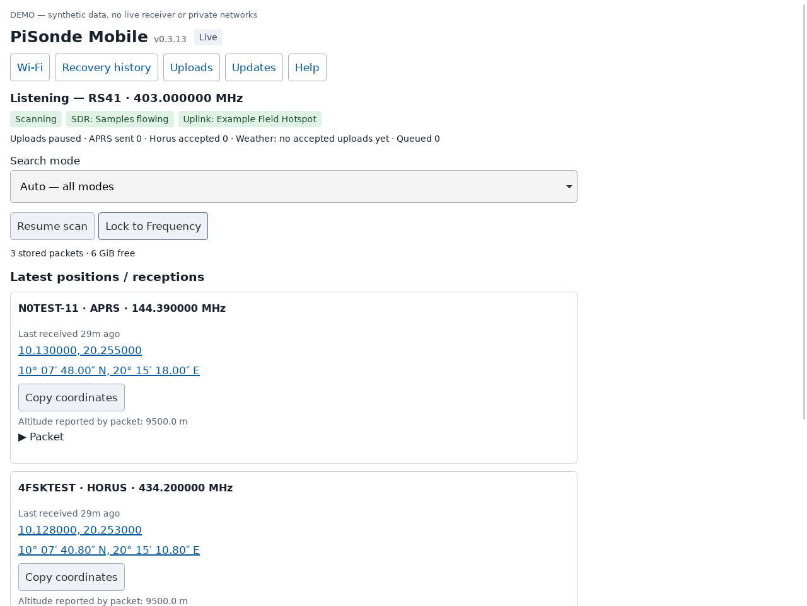
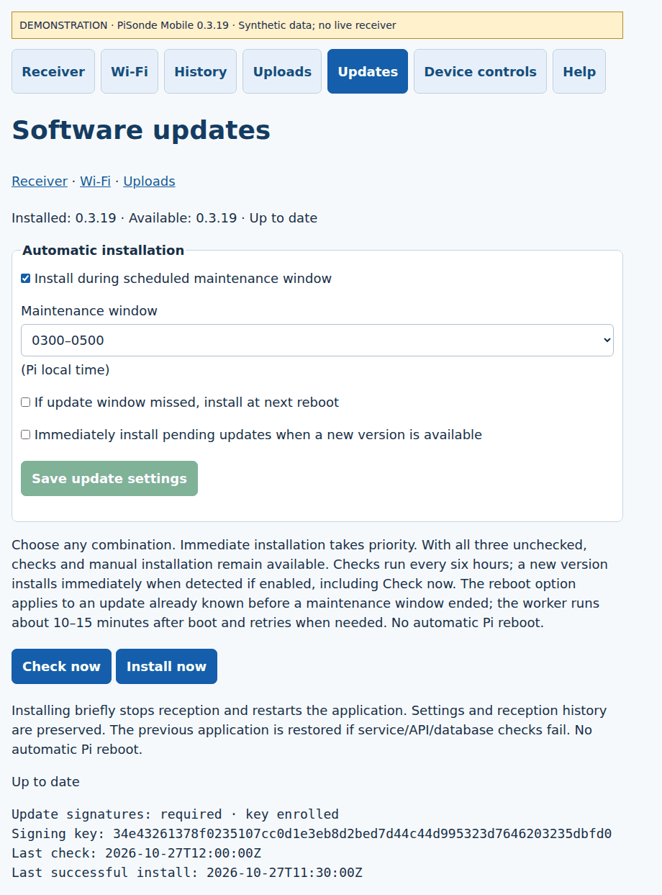
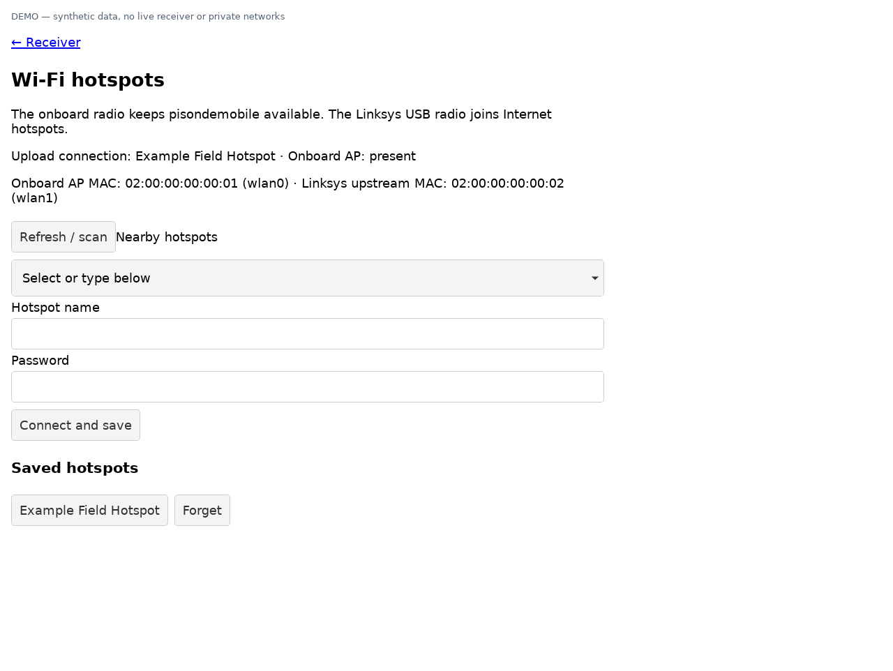
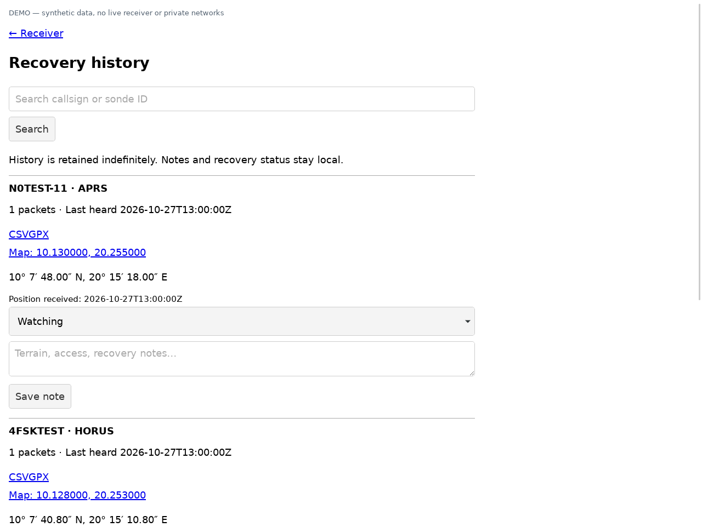
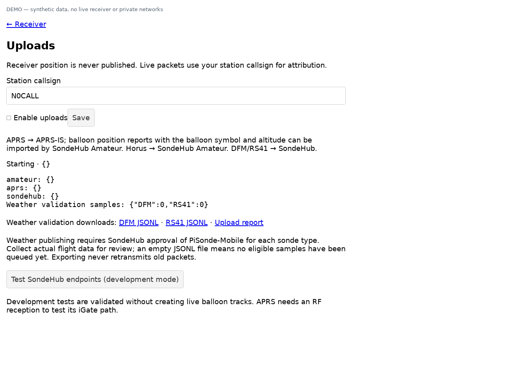

# PiSonde Mobile

A Raspberry Pi field receiver for amateur balloon and weather-sonde recovery: sequential SDR scanning, a simple phone dashboard, and durable local coordinates when recovery has to wait.

**Application: 0.3.17 · Signed application updates**

Fresh installs of 0.3.16 automatically verify the signed release and enroll its public key during setup. Existing enrolled devices update through the GUI. Older unenrolled devices still need one-time [signed-update enrollment](SIGNED-UPDATES.md). Source commits alone do not deploy updates; publisher signature and signed-channel publication are required.

> The receiver has been exercised on the original field Pi. The generalized fresh-install workflow has passed offline tests but still needs an end-to-end test on a fresh Raspberry Pi OS card. Keep a known-working card intact.

## What it does

- Receives APRS, Horus, DFM and RS41 using one RTL-SDR, scanning sequentially.
- Scans APRS 144.390 MHz; Horus 432.501, 434.200 and 434.210 MHz; optional wide Horus and 400–406 MHz weather searches.
- Automatically holds after valid packets; offers manual frequency lock and scan resume.
- Displays payload coordinates in decimal degrees and DMS, with map links and copy controls.
- Stores decoded receptions locally, with recovery notes, CSV/GPX exports and checked rotating database backups. Retention defaults to forever; optional day/low-space policies are under Uploads.
- Provides confirmed Pi restart/shutdown controls and a simple color-coded navigation/action theme.
- Detects stalled or exactly repeating SDR samples, restarts the pipeline and permits bounded resets of the configured SDR.
- Keeps onboard Wi-Fi dedicated to the local access point while USB Wi-Fi connects to upstream hotspots.

A single receiver cannot monitor every frequency simultaneously. Short, infrequent transmissions can be missed while scanning elsewhere.

## Start here

Read the [hardware list](HARDWARE.md) and [installation guide](INSTALL.md).

The initial target is **Raspberry Pi 4, Raspberry Pi OS Lite 64-bit Trixie, RTL-SDR Blog V4 and a Linksys AE6000 USB Wi-Fi adapter**. Other combinations need validation.

On a fresh OS image, connect Ethernet, the SDR and USB Wi-Fi adapter, then:

```sh
sudo apt-get update
sudo apt-get install -y git
git clone https://github.com/johndball/pisonde-mobile.git
cd pisonde-mobile
sudo bash install.sh
sudo reboot
```

After reboot, reconnect over Ethernet or use the console:

```sh
sudo python3 /opt/pisonde-mobile/configure.py
```

Setup detects local hardware identities and asks for a new access-point password. Join **pisondemobile** and open **http://192.168.73.1**. Use the Wi-Fi page to connect the USB radio to an upstream hotspot.

| Adapter | Role |
| --- | --- |
| Onboard Wi-Fi | Local access point; remains available without the USB Wi-Fi adapter |
| USB Wi-Fi | Internet hotspot client |
| RTL-SDR | Shared radio receiver |

This installer refuses an existing `/opt/pisonde-mobile` installation. It is not an in-place updater. Initial setup changes Wi-Fi roles and can disconnect Wi-Fi SSH sessions; retain Ethernet or console access until verified.

## Upload destinations

| Telemetry | Destination |
| --- | --- |
| APRS | APRS-IS; downstream services decide what they ingest/display |
| Horus | SondeHub Amateur |
| DFM / RS41 | SondeHub weather endpoint; **PiSonde-Mobile approval remains pending** |

Uploads start **disabled**, with placeholder callsign `N0CALL`. Enter your own callsign and explicitly enable uploads. SondeHub uses 30-second gzip batches; exact queued weather JSON is available for validation export. The custom software identity is retained. Development validation does not create live balloon tracks. APRS-IS socket writes are not end-to-end delivery acknowledgments.

Receiver position is unpublished. Vehicle GPS/chase-location support has been discussed but is **not implemented in this release**.

## Decoders and development

The weather receiver invokes the established `rs41mod`, `dfm09mod` and `dft_detect` programs from [radiosonde_auto_rx](https://github.com/projecthorus/radiosonde_auto_rx). APRS uses [Dire Wolf](https://github.com/wb2osz/direwolf); Horus uses [horusdemodlib](https://github.com/projecthorus/horusdemodlib).

**The custom Python application, dashboard, integration, setup tooling and tests were developed with substantial ChatGPT/Codex assistance and iterative hardware testing.** The established radio decoders were reused, not generated as replacements. Custom telemetry handling still requires independent validation; automated tests do not constitute SondeHub approval.

The installer pins the two decoder repository revisions. OS/Python dependencies are resolved at installation time; this is a source installer, not a reproducible SD-card image.

## Versions and release notes

Read [CHANGELOG.md](CHANGELOG.md) for the version history and [GitHub Releases](https://github.com/johndball/pisonde-mobile/releases) for tagged source snapshots and per-version notes. Historical 0.3.11 has a known setup defect and is superseded.

## Background updates

Version 0.3.17 retains three independent automatic-install options: a selectable two-hour maintenance window in 24-hour local time, installation at the next reboot after a missed window, and immediate installation when a new version is detected. Checks run about every six hours. Defaults preserve scheduled 0300–0500 installation; the other options start off. Manual checks and installation remain available. Updates use a curated stable manifest pinned to immutable source commits, preserve local configuration/history and attempt rollback on failure.

For an existing device, follow the [one-time updater setup](UPDATES.md). New installations configure update support during initial hardware setup. Application updates do not install OS/dependency changes or database migrations.

## Tests and field checks

The public baseline passed **218 offline regression tests**. With dependencies installed, run from the repository (the signing tests also require `cryptography` in your development environment):

```sh
/opt/pisonde-mobile/venv/bin/python run_tests.py
```

The test runner supplies temporary synthetic hardware identities. Network/service/USB operations are mocked.

After installation:

```sh
sudo /opt/pisonde-mobile/venv/bin/python /opt/pisonde-mobile/verify_recovery.py --field-only
```

Read INSTALL.md before running the optional full recovery test, which deliberately interrupts receiver subprocesses. Verify actual RF decoding, fresh packet timestamps and eligible uploads separately.

## Privacy and operational limits

No personal MAC addresses, saved Wi-Fi profiles, passwords, private recordings or reception databases are distributed. The installing Pi generates hardware settings locally. Do not commit configured device directories or diagnostic exports; they can contain station identities and location data.

The dashboard is local HTTP; keep it on a trusted network and do not expose it directly to the Internet. Dependable power, controlled shutdown and off-device backups remain necessary. The underlying intermittent SDR-stall cause is not conclusively diagnosed. Recovery counters and sample flow alone do not prove useful reception.

See [privacy and validation notes](PRIVACY-AND-VALIDATION.md), [source/license notices](NOTICE.md) and [LICENSE](LICENSE). The PiSonde-specific source uses MIT; the separate modified survey source under `rate-survey/` retains its GPL notices and corresponding source.


## Screenshots

Actual application screens with **synthetic demo data**, not live telemetry or private network details.



| Software updates | Wi-Fi hotspots |
| --- | --- |
|  |  |

| Recovery history | Upload controls |
| --- | --- |
|  |  |

See the [screenshot gallery](docs/screenshots/README.md) for the field guide and weather-validation page.
